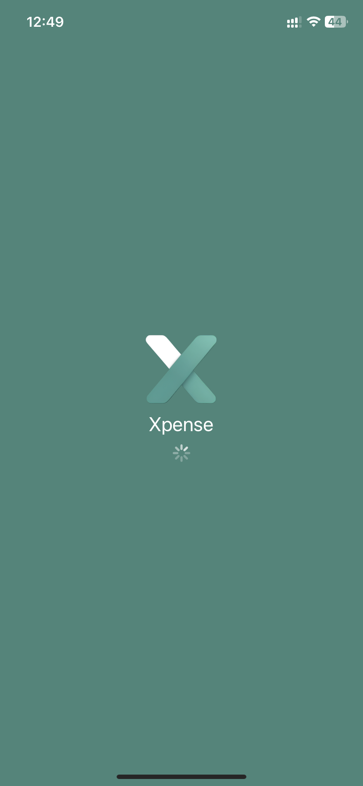
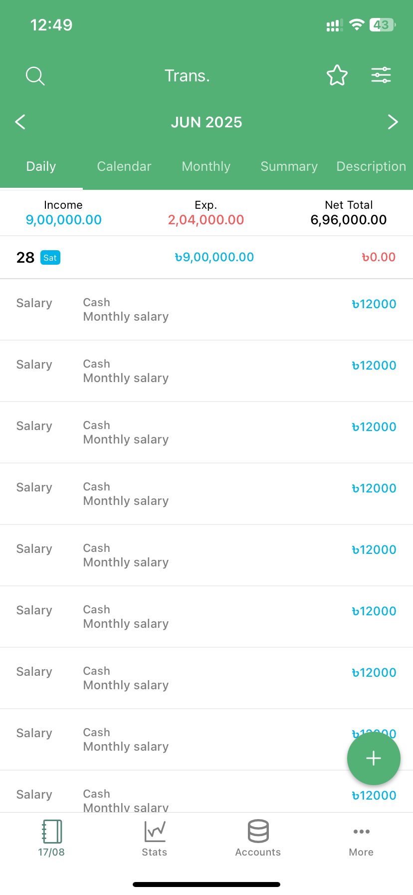

# 📱 React Native Expense Tracker

Track your **monthly expenses** and **transactions** with a clean, fast, and reliable React Native app.

> Tip: This README includes a **Video Demo** section with plug‑and‑play Markdown/HTML snippets so you can showcase your app instantly.

---
## 📹 App ScreenShot

|  |  |
|-------------------------------|-------------------------------|


## 📹 Video Demo

▶️ [Watch on YouTube](https://youtube.com/shorts/ebdxbU5-Sp8?feature=share)


## ✨ Features

- 📊 **Monthly Dashboard**: Total spend, transaction count, top categories
- 💸 **Add Transactions**: Amount, category, date, note
- 🗂 **Categories**: Built‑in + custom categories
- 🔍 **History & Filters**: Filter by date range/category and search by note
- 📅 **Monthly Reports**: Breakdown by category/day
- 📈 **Charts (optional)**: Visualize spending trends
- 🌗 **Themes & Settings**: Currency, first day of month, light/dark mode
- 💾 **Persistence**: AsyncStorage or SQLite; optional backend sync

---

## 🛠 Tech Stack

- **React Native** (Expo)
- **React Navigation**
- **Context API**
- **SQLite**
- **TypeScript**

---

## 🚀 Getting Started

```bash
# 1) Clone
git clone https://github.com/your-username/expense-tracker.git
cd expense-tracker

# 2) Install
npm install
# or
yarn install

# 3) iOS pods (bare RN)
npx pod-install ios

# 4) Run
# Expo
npx expo start
# or Bare RN
npm run android
npm run ios
```

> Ensure your Android/iOS dev environment is set up per the React Native docs.

---

## 📂 Project Structure (example)

```
.
├── src
│   ├── components/
│   ├── screens/            # Dashboard, AddTransaction, History, Reports, Settings
│   ├── navigation/
│   ├── store/ or context/
│   ├── services/           # storage, db, api
│   ├── hooks/
│   ├── utils/
│   └── types/
├── docs/                   # demo.mp4, demo.gif, demo-thumbnail.png
├── assets/
└── README.md
```

---

## 🧮 Data Model (minimal)

```ts
// Transaction
type Transaction = {
  id: string;
  amount: number;      // positive number for expense
  category: string;    // e.g., Food, Transport
  date: string;        // ISO date string
  note?: string;
  createdAt: string;   // ISO
  updatedAt?: string;  // ISO
};
```

---

## 🔧 Configuration

- **Currency**: default currency code (e.g., `USD`, `BDT`)
- **Start of Month**: `1` (default) or custom
- **Theme**: `light` | `dark` | `system`

These can live in a settings screen and/or `.env` file as needed.

---

## 🧪 Testing (optional)

- **Jest** + **React Native Testing Library**
- **Detox** for E2E (Expo Dev Client supported)

---

## 📜 Changelog

See [CHANGELOG.md](./CHANGELOG.md) (create if needed).

---

## 🤝 Contributing

1. Fork
2. Create a feature branch: `git checkout -b feat/my-feature`
3. Commit: `git commit -m "feat: add my feature"`
4. Push: `git push origin feat/my-feature`
5. Open a PR

---

## 📗 License

MIT © 2025 Jahirul Islam
```text
MIT License
Permission is hereby granted, free of charge, to any person obtaining a copy...
```
